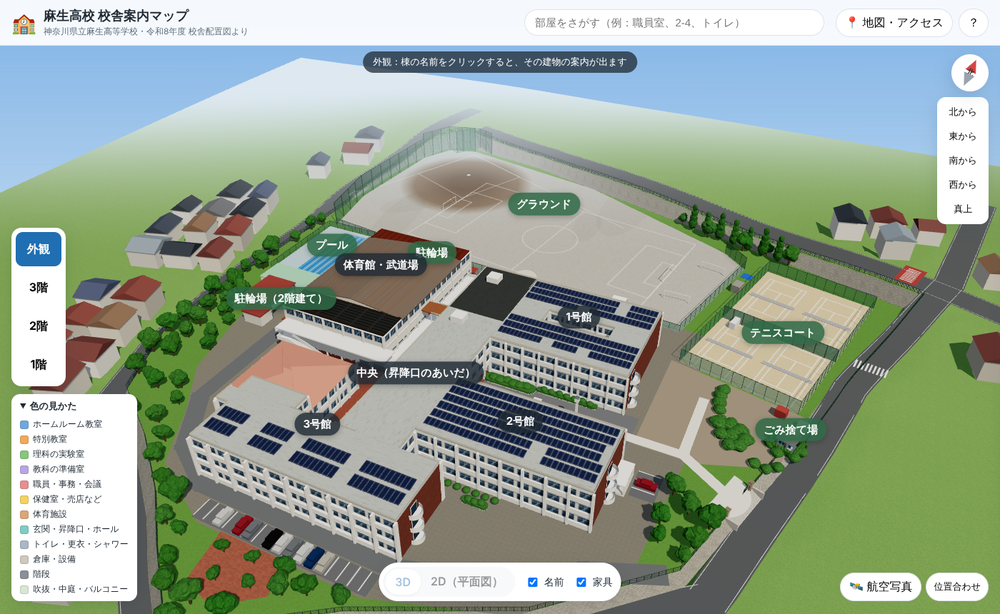
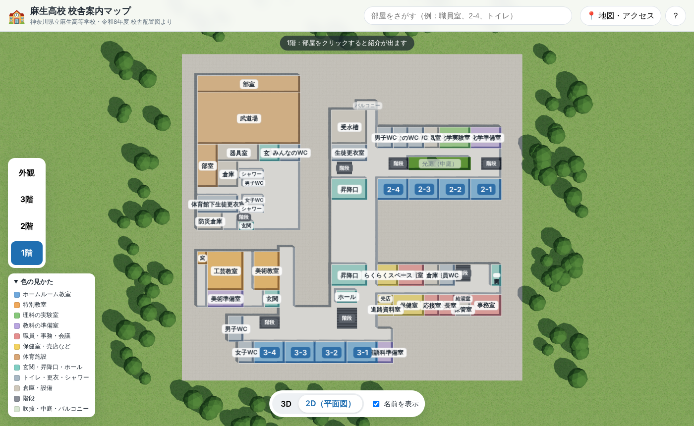
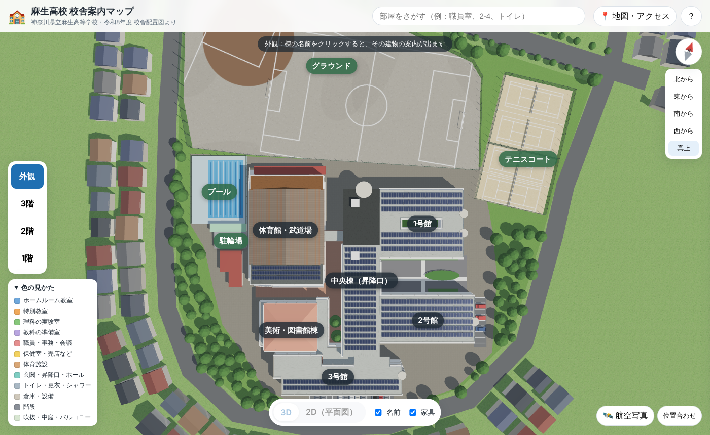
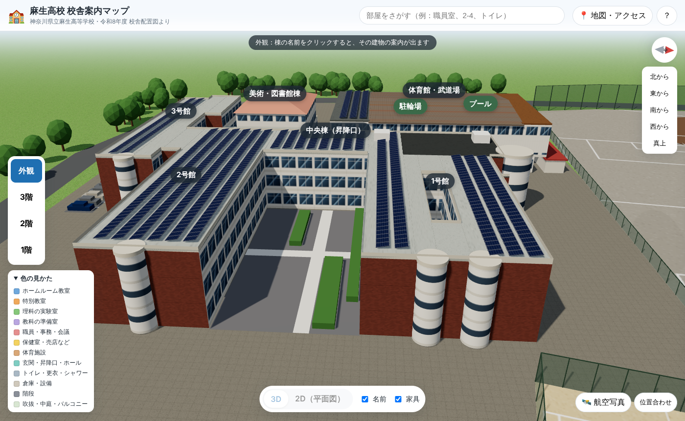
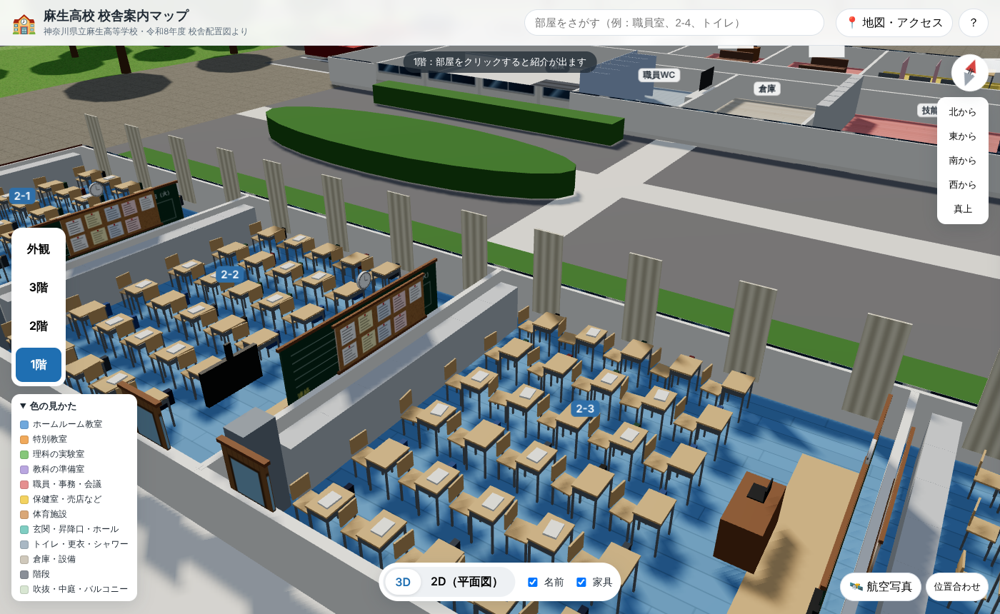

# 麻生高校 校舎案内マップ

神奈川県立麻生高等学校の校舎配置図・案内図を、ブラウザで **3D（立体）** と **2D（平面図）** で見られるようにしたものです。

- **外観**：校舎全体を立体で表示。建物や「1号館」などの名前を押すと、その建物にある部屋の一覧が出ます。
- **1階・2階・3階**：その階の部屋を色分けで表示。部屋を押すと、紹介文と「近くのトイレ・階段」が出ます。
- **2D（平面図）**：上から見た案内図に切り替えられます。
- **検索**：「職員室」「2-4」「トイレ」などで部屋を探せます。
- **部屋へのリンク**：`index.html#room=F2-AY126` のように、部屋を開いた状態のURLを共有できます（QRコードにして掲示するのにも使えます）。
- **教室の中**：各階の表示で、机・椅子（少しずつずれている）・教科書・かばん・黒板（日付と日直）・時計・テレビ・掲示板・掃除用具入れ・引き戸・カーテン、実験台、本棚、パソコン、ベッド、下駄箱などを部屋の種類に合わせて表示します（並び方はイメージです）。
- **校舎のまわり**：グラウンド（野球・サッカー）、テニスコート、プール、駐輪場（推定）、並木。位置は航空写真から読み取ったもので、`js/info.js` の `SITE` で変えられます。
- **屋根**：航空写真に合わせて、1・2・3号館の太陽光パネル、1号館（音楽室側）の黒い屋根、体育館の茶色い金属屋根、図書室の棟のピンクの寄棟屋根を再現しています。
- **航空写真**：国土地理院の航空写真を地面に表示し、「位置合わせ」で校舎と重ねられます。合わせた数字を `js/info.js` の `AERIAL_ALIGN` に書くと全員の画面に反映されます。
- **校舎のまわり（再現）**：敷地の形（道路の内側）、舗装と植え込み、まわりの住宅地、体育館の西側の通路と外階段・南側の2階テラスと外階段、白い壁の柱と庇（ひさし）。
- **斜面と擁壁**：学校は斜面に建っていて、北の道路は敷地より高く（敷地の内側に擁壁）、南の道路は敷地より低い（敷地の外側に擁壁）。敷地のまわりには柵があり、東と西に門があります（`js/info.js` の `SITE.slope`・`SITE.gates`）。
- **軽さの工夫**：柵・フェンス・道路の線など動かない屋外の部品は、材質ごとに1つの形にまとめて描いています（描画回数を約2300回→約200回に）。木・家はまとめて描く仕組み（InstancedMesh）です。
- **まわりの風景**：軽くするため、学校のまわりの家並みは近くだけ（半径約135m）にして、遠くは霧で消えます。となりの小学校・中学校は描いていません（`js/info.js` の `SITE.showNeighbors` を `true` にすると出ます）。
- **見る方向**：右上の「北から・東から・南から・西から・真上」で視点を切り替えられます。方位磁針で北の向きがわかります。
- **地図・アクセス**：Googleマップ（航空写真）と所在地・アクセス情報。

| 3D（外観） | 2D（平面図） |
| --- | --- |
|  |  |







## 見かた（公開のしかた）

GitHub Pages で公開すると、スマホやパソコンのブラウザからURLで開けます。

1. GitHub のこのリポジトリで **Settings → Pages** を開く
2. **Source** を「Deploy from a branch」、**Branch** を `main` / `/ (root)` にして **Save**
3. 数分後に `https://nakatadaiki1012-design.github.io/school-building/` で見られるようになります

※ `index.html` をパソコンでダブルクリックして開くだけでは動きません（ブラウザの制限のため）。GitHub Pages などのWebサーバーで開いてください。

## データについて

- 部屋の位置・大きさ・名前は、学校の「令和8年度 校舎配置図」（Excel）のセルから自動で読み取っています。
- 階段の位置は図面の記号から読み取ったおおよその位置です。
- **航空写真のトレース**：プールの水面（25m）を物差しにして、航空写真で各棟（1・2・3号館、中央棟、体育館、3号館の美術・図書館の部分など）の位置と大きさを測り、図面の部屋の並びをそのまま、棟ごとに伸び縮みさせて実際の位置に合わせています（`js/info.js` の `BLOCKS`）。家具は伸び縮みさせず、合わせたあとの部屋の大きさに置き直しています。
- 屋根・屋外施設（グラウンド・テニスコート・プール・駐輪場・道路・駐車場）の位置もGoogleマップの航空写真をもとにしています。
- 外壁はGoogleマップの3D表示の写真をもとに、教室棟の長い面は白、棟の東西の端の壁と中央棟の北側は茶色いレンガタイル、端には白い丸い階段塔、中央棟の北東には白い円筒形の塔、としています（`js/info.js` の `FACADE`）。
- 普通教室は40人分の机で、黒板が西側、左前（窓側）に大型の電子黒板。特別教室は黒板・教卓・教壇が北側（調理室とコンピューター教室は南側）になるように家具を置いています。
- 2つの昇降口のあいだは、レンガ敷きの屋外（上に2・3階がのった吹きさらし）です。
- 学校の所在地・アクセスはインターネット上の公開情報をもとにしています。

## 部屋の紹介文を書きかえるには

`js/info.js` の `RULES`（部屋名ごとの紹介文）を書きかえてください。建物（号館）の説明は同じファイルの `WINGS` です。

## 図面が新しくなったとき

新しい校舎配置図（Excel）から部屋データを作り直せます（Python と openpyxl が必要です）。

```
python3 tools/excel_to_data.py 校舎配置図.xlsx js/data.js
```

## ファイル構成

| ファイル | 内容 |
| --- | --- |
| `index.html` | ページ本体 |
| `css/style.css` | 見た目（デザイン） |
| `js/app.js` | 3D表示・クリック・検索などの動き（three.js を使用） |
| `js/info.js` | 建物の形、階段、色分け、紹介文、学校情報、屋外施設の位置、航空写真の位置合わせ |
| `js/furniture.js` | 部屋の中の家具と床の模様 |
| `js/site.js` | グラウンド・テニスコート・駐輪場、航空写真 |
| `js/data.js` | Excel から自動生成した部屋データ |
| `tools/excel_to_data.py` | Excel → `js/data.js` の変換スクリプト |
